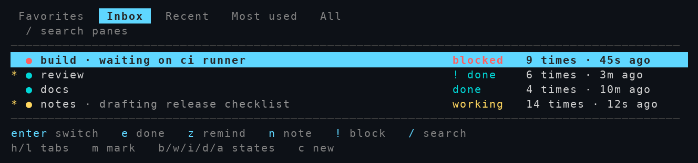
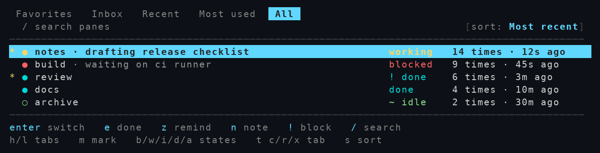
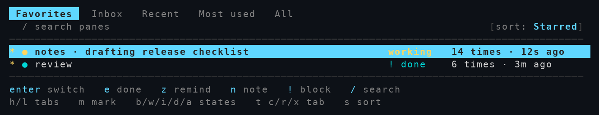
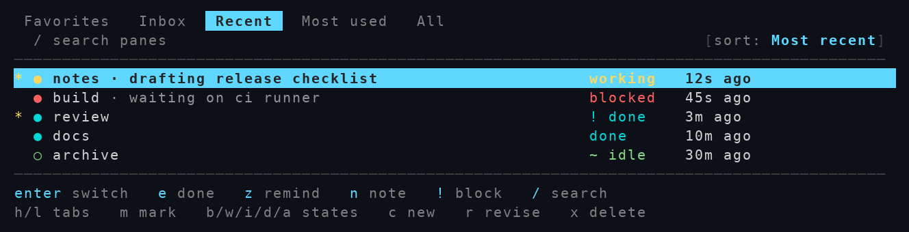
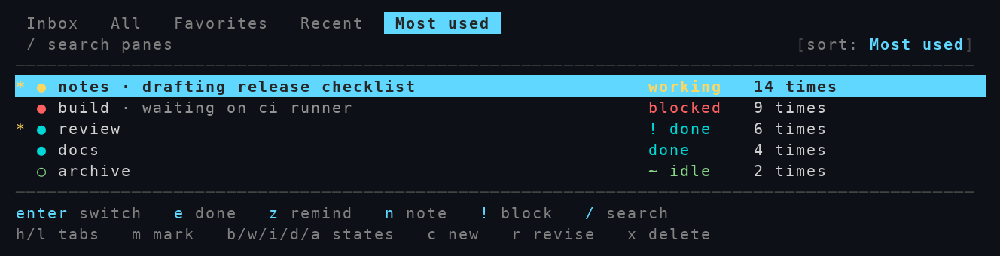
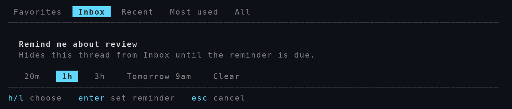
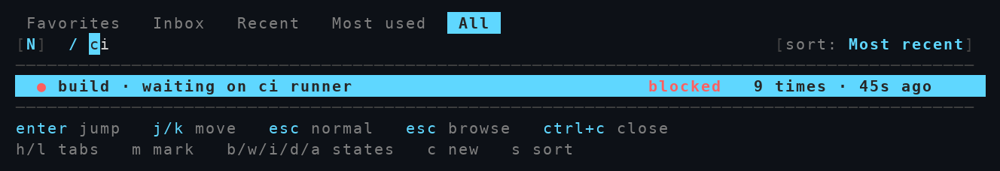

# herdr-recall

A Superhuman-style agent triage inbox and pane recall picker for [Herdr](https://herdr.dev).
When you switch across 20 to 30 live agent threads to give quick feedback and unblock work, `herdr-recall` keeps track of which threads need a cycle-back, lets you leave sticky notes and reminders, and jumps straight to any pane from `prefix+k`.

See [VISION.md](VISION.md) for the project vision and acceptance policy.

Press `prefix+k` and the picker opens as a 95% by 95% popup. The pane you are
sitting in never appears in `Inbox`: opening the picker bumps it to most
recent, so it would otherwise always top the triage list and Enter on it
would go nowhere.
Tabs from left to right are `Favorites`, `Inbox`, `Recent`, `Most used`, and `All`.
`Recent` and `Most used` start as custom tabs. `t c` creates one, `t r` revises it, and `t x` deletes it after a confirmation.

In `Inbox`, press `e` to mark a thread Done for the current cycle.
Done is not mute: any new agent activity brings the thread back to `Inbox`.
The row leaves the list you are looking at, on every tab, the way Superhuman
archives out of whatever view you are triaging. On the reference tabs the
limit is applied after done rows are hidden, so a limit of 50 always shows 50
live rows instead of losing slots to hidden ones. `u` undoes the last `e` and
the row returns to the top of the list. A thread also returns on its own when
its agent does something new. A snoozed row is different: it keeps its `~`
badge and stays visible until the reminder is due.
Viewing a pane is you reading, not the agent moving, so it never returns a thread and never moves the pinned queue.
Press `e` again on that row to undo.
Press `z` to snooze a thread (`20m`, `1h`, `3h`, `Tomorrow 9am`, or `Clear`).
The snooze carries a return rule: `If no reply` breaks early on new agent activity, `Regardless` keeps the timer.
Press `n` to leave a one-line sticky note beside the tab name.
Press `!` to toggle a manual `blocked` override when a thread is waiting on something outside Herdr's detector.

## Keys

| Key | Action |
| --- | ------ |
| `prefix+k` | open the recall and triage popup |
| `j` / `k` / `↑` / `↓` | move one row, or N rows with a count such as `3j` |
| `g` / `G` | jump to the first / last row |
| `ctrl+u` / `ctrl+d` | half-page up / down (in search or note: `ctrl+u` clears text) |
| `h` / `l` / `←` / `→` | switch tabs (`Favorites`, `Inbox`, `Recent`, `Most used`, `All`) |
| `enter` | focus the selected pane directly via Herdr socket |
| `e` | mark done. The row leaves the current list. `u` undoes |
| `z` | snooze with a typed time (`3h`, `2w`, `1d12h`, `tomorrow`, `clear`) and a return rule: `If no reply` (default) or `Regardless` |
| `n` | set or edit a sticky note on the selected thread |
| `!` | toggle manual `blocked` override on the selected thread |
| `m` | mark or unmark the selected thread as a favorite (`*`) |
| `i` | teach Jev on the selected thread, saving full context to `jev-teachings.jsonl` |
| `+` / `-` | quick prefer / demote selected thread for Jev |
| `J` | inspect and correct Jev learned feature weights |
| `b` / `w` / `i` / `d` / `a` | filter by status: blocked, working, idle, done, or all |
| `/` | search tab names and sticky notes, with vim editing |
| `t` then `c` / `r` / `x` | create, revise, or delete a custom tab |
| `s` | cycle sort (`Most recent`, `Oldest`, `Most used`, `Least used`) on `All` and `Favorites` |
| `?` | open or close help |
| `esc` | insert to normal, normal to browse, then clears the search words, then the status filter, then closes |
| `ctrl+c` | close from anywhere |

The footer shows the keys for the mode you are in: key names in accent,
hint words dim, the same way `prefix+k` does. Status appears as a coloured
dot plus a coloured word (red blocked, yellow working, teal done, green
idle), section headers are coloured, and the favourite star is yellow.

## Vim editing

`/` search and `n` sticky note share one vim line editor, so both feel the same.

- `esc` or `jj` enters normal mode. `i`, `I`, `a`, `A` go back to insert.
- Motions: `w` `W` `b` `B` `e` `E`, `0` `^` `$`, `f` `F` `t` `T`, `;` `,`.
- Edits: `x` `X`, `r{char}`, `s`, `d` `c` `y` with a motion, `D`, `C`, `Y`.
- `p` `P` paste, `u` undo, `ctrl+r` redo, `~` swap case, `.` repeat.
- Counts work, so `3w`, `2dw`, `5x` all behave.
- `jj` leaves insert mode, with a 150 ms window before a lone `j` lands.
- `esc` unwinds one thing per press: insert to normal, normal to browse with
  the filter kept, then the search words clear, then the status filter, then
  the picker closes.
- While a field is focused, `j` `k` and the arrows move the list and `enter` jumps.

A mode chip sits left of the prompt: `N` normal, `I` insert, `R` replace, and
`d` `c` `y` `f` `r` when a command is waiting on its motion. The cursor is
painted in the line, so it matches the screenshots exactly.

## Remind times

`z` takes a typed time. Units are `min`, `h`, `d`, `w`, `mo`, `y`, and `m`
means months to match the `3h 3d 2w 2m` scale, so minutes are always `min`.
Compound sequences work (`1d12h`), bare units mean one (`h`), `a` and `an`
mean one, and `tomorrow` is 9 AM. The resolved absolute time is shown while
you type, so an ambiguous unit is visible before it commits. `clear` removes
the reminder.

## Jev triage priority

Jev is optional. With no decision proxy on the box and no `HERDR_RECALL_JEV`
override, the picker behaves exactly as it does without this section.

When Jev is present, each new Inbox arrival is asked one question: should the
captain triage this thread before the others right now. New arrivals are then
placed at the front of the queue, most important first. Existing rows keep
their pinned positions, so reviewing a thread never reshuffles the queue.

Preference is learned locally. Acting on an Inbox row reinforces its features
(status, note, age, label) and decays the features of the rows skipped above
it, so the ordering drifts toward what you actually handle first.

Explicit feedback is faster: `+` on a row tells Jev to rank threads like it
higher,  tells it to rank them lower. The bump is double the implicit
rate. It works without the decision proxy, since the weights are local.

Press `J` to inspect what Jev has learned. Weights sort by impact,
positive green and negative red. Enter clears one, ctrl+u clears all.
The CLI can do the same: `herdr-recall jev` lists, `jev reset` clears,
`jev reset status:blocked` clears one, `jev scores` shows the API scores.

## Screenshots

Inbox triage view (default view with pinned queue order, sticky notes, and due `!` reminder badge):



All view showing all four status colours (red blocked, yellow working, teal done, green idle) and a snoozed `~` reminder badge:



Favorites view (`[sort: Starred]`):



Recent view (`[sort: Most recent]`):



Most used view (`[sort: Most used]`):



Snooze dialog after pressing `z`, with the return rule as a field:



Search with the shared vim editor. The chip shows the mode and the cursor is painted in the line:



The picker draws to the width of the pane it opens in, measured from its own
tty, so a row never wraps even in a narrow overlay.

## Install

Needs Go 1.26+ and Herdr 0.8.0 or newer.

```sh
herdr plugin install RooseveltAdvisors/herdr-recall --ref main --yes
herdr server reload-config
```

Herdr keeps the installed copy in its own plugin folder. Do not clone the
repo into `~/code` and link that path. A missing checkout makes the keybinding
fail or open an old copy.

Then bind it in `~/.config/herdr/config.toml`:

```toml
[[keys.command]]
key = "prefix+k"
type = "plugin_action"
command = "RooseveltAdvisors.herdr-recall.open-picker"
description = "recall picker"
```

and run `herdr server reload-config`.

## Where state lives

`herdr plugin config-dir RooseveltAdvisors.herdr-recall` prints the directory;
the state file is `recall.json` inside it. It records, per pane: visit count,
last-seen time, and the label shown in the list, plus the favorites list.
Rows for closed panes are pruned past 200.
A live pane keeps its triage state no matter how long it sits.

## How jumping works

Enter sends `pane.focus` directly over `HERDR_SOCKET_PATH` for the selected live pane.

## Companion CLI

- `herdr-recall stats` - print the current state JSON
- `herdr-recall record` - record the focused pane now
- `herdr-recall jump <pane-id>` - jump without the picker
- `herdr-recall favorite <pane-id>` - toggle a favorite
- `herdr-recall render` - print one picker frame (honours `RECALL_QUERY`,
  `RECALL_SEL`, `RECALL_W`, `RECALL_H`, `RECALL_STATUS`); used for tests and
  screenshots
